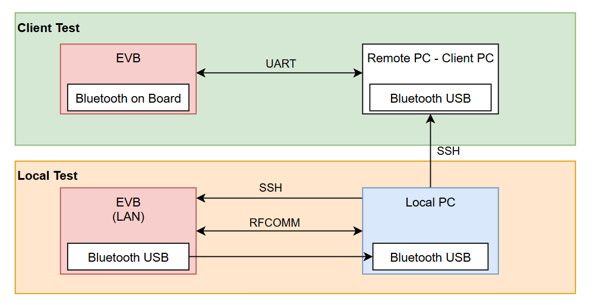

# Test plan Bluetooth: board ↔ PC

> Phạm vi: kết nối Bluetooth Classic (RFCOMM) giữa board Linux và PC: pairing, kết nối, gửi/nhận dữ liệu, throughput, latency, độ ổn định.
> Công cụ: `ctt-agent.exe` / `ctt-agent-console.exe` trên PC, `ctt-agent` trên board ([bt-app.md](bt-app.md)). Test case chi tiết: [bt-test-cases.md](bt-test-cases.md).

## 1. Hiện trạng: hai setup

| | **Local Test (LT)**: đang có | **Client Test (CT)**: đích cuối |
|---|---|---|
| Bluetooth phía board | **USB dongle** cắm vào EVB | **Chip Bluetooth trên board** (phần cứng sản phẩm) |
| Bluetooth phía PC | USB dongle trên Local PC | USB dongle trên Client PC |
| Điều khiển board | **SSH qua LAN** | **Chỉ UART** (không có mạng) |
| Người test ngồi ở | Local PC | Local PC, **SSH vào Client PC** |
| App dùng | `ctt-agent.exe` (GUI) hoặc console | `ctt-agent-console.exe` (chạy qua SSH, không có cửa sổ) |
| Kết quả phản ánh | Tool, phương pháp, phần mềm BlueZ/agent | **Sản phẩm thật** (chip, anten, firmware) |

Hai điểm khác biệt quyết định cách test:

1. **Phần cứng Bluetooth khác nhau.** Ở LT, board dùng dongle USB chứ không dùng chip trên board, nên số đo ở LT **không phải số của sản phẩm**. LT dùng để chứng minh tool và quy trình đúng, và để có số tham chiếu; số dùng để chấp nhận (acceptance) phải lấy ở CT.
2. **CT không có SSH tới board.** App không tự chạy agent, tự xác nhận pairing hay mở pipe trên board được. Mọi thao tác phía board ở CT làm **thủ công qua UART** (hoặc bằng service đã cài sẵn trong image), và app chạy ở chế độ **No SSH** (GUI: tick "No SSH"; console: menu 1, `SSH to the board?` = `n`).

## 2. Mục tiêu

| # | Mục tiêu | Đo bằng |
|---|---|---|
| G1 | PC tìm thấy và pair được với board, lặp lại ổn định | Scan / Pair; pair-stress |
| G2 | Kết nối RFCOMM mở được và giữ được | Terminal / throughput |
| G3 | Dữ liệu đi đúng **cả hai chiều**: không mất, không sai, đúng thứ tự | Terminal (nhìn tận mắt) + CTP (seq, CRC) |
| G4 | Throughput mỗi chiều và hai chiều cùng lúc | Throughput `tx`, `rx`, `bidir` |
| G5 | Độ trễ ứng dụng (RTT) | `echo` |
| G6 | Độ ổn định: chạy dài, mất/khôi phục kết nối | Long run, reconnect |

## 3. Chiến lược theo giai đoạn

### Giai đoạn 0: Tool sẵn sàng (không cần phần cứng)
- `scripts/build-host.sh` (unit + loopback test) và `python3 -m ctt selftest`: PASS.
- GitHub Actions build được `ctt-agent.exe`, `ctt-agent-console.exe` và agent aarch64.

**Điều kiện qua:** toàn bộ test PASS, có đủ 3 file binary.

### Giai đoạn 1: Local Test, kiểm chứng tool và lấy số tham chiếu
1. **Baseline link, chưa dùng tool** (bắt buộc trước khi đo throughput):
   - trên board: `l2ping -s 1000 -f -c 2000 <PC addr>`, cho biết khả năng thô của ACL;
   - `btmon` trong lúc đo, ghi lại: loại gói ACL (2-DH5/3-DH5 hay DH1/DM1), RFCOMM frame size (PN), credit, `Mode Change` (sniff);
   - `hciconfig hci0` trên board: ACL MTU, packet type.
2. **Chạy đủ bộ test case** TC-01 … TC-19 ([bt-test-cases.md](bt-test-cases.md)) bằng GUI. Lặp lại một lượt bằng console để chứng minh hai app cho cùng kết quả.
3. **So sánh phía PC**: đo cùng dongle trên Windows (`ctt-agent.exe`) và trên Linux native (`python3 -m ctt.btapp`, hoặc `ctt run -t rfcomm`). Nếu Linux nhanh hơn rõ rệt thì giới hạn nằm ở stack Windows, không phải ở board.
4. **Ma trận block size**: 990 / 2048 / 4096 / 8192. Mỗi ô **đo 3 lần × 30 s**, ghi min/avg/max.

**Điều kiện qua:** G1–G3 đạt; có bảng số tham chiếu kèm điều kiện đo; đã giải thích được giới hạn throughput (dựa vào btmon và l2ping).

### Giai đoạn 2: Chuẩn bị Client Test
| Việc | Cách làm |
|---|---|
| Có agent trên board mà không cần mạng | Đưa `ctt-agent` vào image (recipe Yocto, xem [yocto-recipe.md](yocto-recipe.md)) và bật `ctt-agent-bt.service` (channel 22). Tạm thời có thể copy bằng USB stick, hoặc truyền qua UART (`lrzsz`, base64) |
| Truy cập Client PC | Bật OpenSSH Server trên Client PC; copy `ctt-agent-console.exe` sang; cắm dongle |
| Truy cập UART | Mở terminal serial (PuTTY / `screen /dev/ttyUSB0 115200`) tới board, đăng nhập root |
| Thủ tục pairing phía board | `bluetoothctl` (agent, pairable, discoverable), hoặc công cụ của daemon BT riêng của board, khai báo trong board profile (xem [bt-app.md](bt-app.md#chuẩn-bị-board-khi-không-có-ssh)) |

**Điều kiện qua:** từ Local PC, SSH vào Client PC chạy được `ctt-agent-console.exe --version`; trên UART, `ctt-agent version` chạy được.

### Giai đoạn 3: Client Test (số của sản phẩm)
Hướng dẫn từng bước: [bt-client-test.md](bt-client-test.md).

- Chạy lại bộ test case ở chế độ **No SSH** bằng `ctt-agent-console.exe`. Cột "CT" trong [bt-test-cases.md](bt-test-cases.md) ghi rõ phần nào làm thủ công trên UART.
- Đo có ngưỡng: `ctt-agent-console suite --addr <ADDR> --channel 22 -l target` (BT-TP-01…06, tự lưu JSON + CSV), cộng log UART và `btmon` của board.

**Điều kiện qua:** `suite -l target` báo `6/6 PASS`, và đạt các tiêu chí khác ở mục 5.

### Giai đoạn 4: Regression
Với mỗi build firmware mới, chạy lại: TC-05 (pair), `suite -l baseline` (LT) hoặc `-l target` (CT) cho TC-10…TC-14, và TC-16 (long run 10 phút). So sánh file `ctt-results/suite-*.csv` với kết quả của build trước.

## 4. Ma trận: test case × setup × app

Test case chi tiết viết cho Client Test với 2 tổ hợp: **A** = board UART + `ctt-agent-console.exe` qua SSH, **B** = board UART + `ctt-agent.exe` (GUI). Xem [bt-test-cases.md](bt-test-cases.md).

| Nhóm | Test case | CT-A (UART + console) | CT-B (UART + GUI) | LT (SSH tới board) |
|---|---|:-:|:-:|:-:|
| Chuẩn bị | P-01 version, P-02 BT board, TC-01 PC Bluetooth / No SSH | ✔ | ✔ | ✔ (Check board, Deploy agent) |
| Pairing | TC-04 scan, TC-05 pair, TC-18 bỏ pair / pair lại | ✔ (board xác nhận qua UART) | ✔ | ✔ (board tự xác nhận) |
| Dữ liệu thô | TC-06 kết nối, TC-07 PC→board, TC-08 board→PC, TC-09 hex, TC-09b đếm đủ | ✔ (`ctt-agent pipe --text` trên UART) | ✔ | ✔ (khung Board) |
| Throughput | TC-10 tx, TC-11 rx, TC-12 bidir, TC-14 block size | ✔ | ✔ | ✔ |
| Latency | TC-13 echo | ✔ | ✔ | ✔ |
| Cả bộ | TC-20 suite BT-TP-01…06 | ✔ | – | ✔ |
| Ổn định | TC-15 dừng giữa chừng, TC-16 long run, TC-17 reconnect | ✔ | ✔ | ✔ |
| Báo cáo | TC-19 lưu kết quả | `--json`, `ctt-results/` | Save results | ✔ |

## 5. Tiêu chí PASS (ngưỡng đã có trong tool, chốt lại sau Giai đoạn 1)

| Chỉ số | Tiêu chí |
|---|---|
| Toàn vẹn dữ liệu (mọi test) | mất gói = 0, lỗi CRC = 0, sai thứ tự = 0 |
| Pairing | ≥ 98% thành công trên 50 lần (pair-stress) |
| Throughput mỗi chiều | Level `target`: PC→board và board→PC **≥ 1.0 Mbit/s** (block 990 và 4096); `bidir` mỗi chiều **≥ 0.5 Mbit/s**. Level `baseline` (regression của LT): PC→board ≥ 0.25, board→PC ≥ 0.40 Mbit/s. Bảng đầy đủ: [bt-test-cases.md](bt-test-cases.md#level-chỉ-đo-hoặc-có-ngưỡng-pass) |
| RTT (`echo`, block 64 B) | p99 ≤ 100 ms (`target`), ≤ 250 ms (`baseline`). Chốt lại sau Giai đoạn 1 |
| Long run | 10 phút `bidir` không rớt kết nối; throughput không giảm quá 20% so với phút đầu |

## 6. Ghi nhận mỗi lần đo

- Setup (LT / CT), phiên bản: commit của tool, image của board, driver dongle trên PC.
- Khoảng cách, vật cản, nguồn nhiễu 2.4 GHz (WiFi), các adapter BT khác đang bật trên PC.
- File kết quả (CSV/JSON), log `btmon`, nhật ký của app.

## 7. Những gì còn thiếu

| # | Thiếu | Ảnh hưởng | Đề xuất |
|---|---|---|---|
| 1 | **Điều khiển board qua UART** | CT phải làm tay: chạy agent, xác nhận pairing, mở pipe | Thêm `SerialBoard` cùng interface với `Board` (chạy lệnh qua cổng COM). `BtTestService` không phải đổi, chỉ cần chọn kiểu kết nối board |
| 2 | Đưa agent lên board qua UART | Phải dùng image có sẵn agent, hoặc USB stick | Ưu tiên image có `meta-ctt` |
| 3 | ~~Console chưa lưu kết quả như nút "Save results" của GUI~~ | Đã có: `suite` và menu 10 tự lưu JSON + CSV vào `ctt-results/` | – |
| 4 | Long run / reconnect chưa tự động | TC-16, TC-17 làm tay | Thêm vòng lặp `run` có đếm số lần kết nối lại |
| 5 | Throughput đo được trên Windows thấp (0.3–0.6 Mbit/s, xem `report.md`) | Chưa biết giới hạn nằm ở đâu | Làm baseline ở Giai đoạn 1 bước 1 và 3 trước khi kết luận |

## 8. Rủi ro

- **Dongle trên board ở LT** có hiệu năng khác chip trên board, nên không dùng số LT để chấp nhận sản phẩm.
- **Stack Bluetooth của Windows** có thể là nút cổ chai (xem `report.md`). Cần đối chứng bằng host Linux.
- **Board có thể giới hạn số bond** (đặt `bluetooth.max_bonds` trong board profile để app cảnh báo). Pair lặp lại nhiều lần thì dọn bond trước khi test.
- **UART** chậm và dễ lẫn log của kernel. Nên giảm log level (`dmesg -n 1`) khi chạy agent bằng tay.
